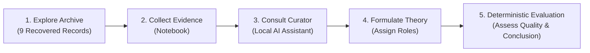
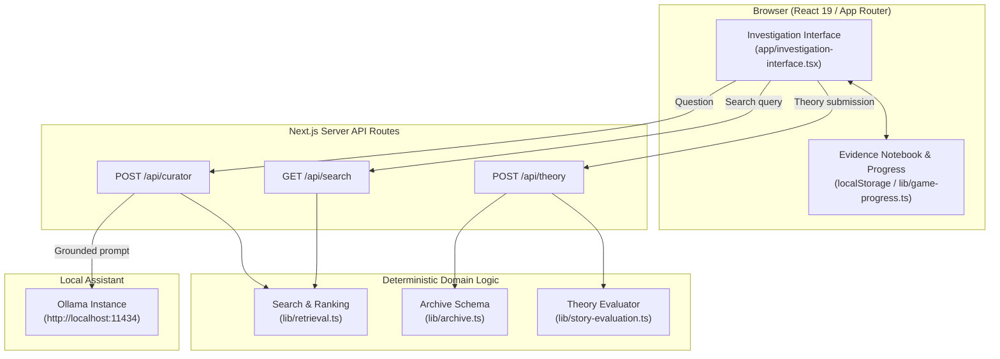

# ARCHIVE 09 — The Internet That Forgot You

> *"Some websites disappear. Some records survive. Not every surviving record tells the truth."*

**ARCHIVE 09** is a digital archaeology and internet-horror investigation game built with Next.js App Router, TypeScript, and Tailwind CSS. The player investigates the **October 16 Incident** through surviving fragments recovered from **October Online**, an early-2000s community website that announced its permanent shutdown on October 12, 2009, yet displays anomalous post-shutdown activity and conflicting timestamps through October 20, 2009.

The central narrative principle of the investigation is:
> **The player can solve the technical incident without solving the operator's identity.**

All individuals, websites, records, logs, and events depicted in this project are entirely fictional.

---

## Table of Contents

- [Overview & Gameplay Loop](#overview--gameplay-loop)
- [Key Features](#key-features)
- [Recovered Archive Directory](#recovered-archive-directory)
- [System Architecture](#system-architecture)
- [Theory Evaluation Engine](#theory-evaluation-engine)
- [API Reference](#api-reference)
  - [`GET /api/search`](#get-apisearch)
  - [`POST /api/curator`](#post-apicurator)
  - [`POST /api/theory`](#post-apitheory)
- [Project Structure](#project-structure)
- [Prerequisites & Requirements](#prerequisites--requirements)
- [Quick Start Guide](#quick-start-guide)
- [Configuration & Environment Variables](#configuration--environment-variables)
- [Testing & Quality Assurance](#testing--quality-assurance)

---

## Overview & Gameplay Loop

Players step into an archival terminal accessing recovered mirror snapshots of `october-16.net`:



1. **Explore the Archive:** Browse five directory categories (Archived Home, Forum, Guestbook, User Profile, System Records) or execute full-text search.
2. **Collect Evidence:** Open individual records to inspect metadata, timestamps, author information, content, and reliability tiers (High, Medium, Low), adding key findings to the Evidence Notebook.
3. **Consult The Curator:** Pose questions to an AI archival assistant grounded strictly in recovered records. Citations must match verified record IDs; if the local model is offline, direct excerpts are provided deterministically.
4. **Formulate a Theory:** Select one of three competing theories, select at least two supporting records and at least one complicating record from the notebook, and articulate an unresolved question.
5. **Deterministic Review:** Submit the investigation to receive server-computed evaluations of theory fit, reasoning rigor, evidential critiques, and the canonical conclusion.

---

## Key Features

- **Retro Archive Terminal UI:** Designed with late-2000s browser aesthetics, including window chrome, mock navigation bars, reliability badges, and theme switching (Light Mode / Dark Mode).
- **Deterministic Full-Text Search:** Unicode-normalized (`NFKC`) search with punctuation stripping, token weighting, and exact/partial matching across title, content, author, type, date, and index tags.
- **Client-Side Progress & Storage Sync:** Local persistence with `localStorage` across tabs via custom window events, resilient session fallback when storage is restricted, and versioned schema parsing.
- **AI Curator with Prompt Isolation:** Local Ollama integration (`qwen2.5-coder:3b`) protected by strict prompt isolation against jailbreaks and untrusted text injection, mandatory citation extraction, and deterministic offline fallback.
- **Deterministic Evaluation Engine:** Server-side theory validation separating player role selections from evidential strength, preventing false reports of missing complicating evidence, and keeping canonical conclusions strictly segregated from player hypotheses.

---

## Recovered Archive Directory

The canonical collection consists of nine unique recovered records stored in [`data/archive.json`](data/archive.json):

| Record ID | Title | Type | Date | Author | Reliability | Significance |
|---|---|---|---|---|---|---|
| **ARC-001** | Final Shutdown Notice | `homepage` | 2009-10-12 | `site_admin` | High | Official closure announcement; notes that backups may remain in circulation. |
| **ARC-002** | The Last Forum Post | `forum` | 2009-10-15 | `night_owl` | Medium | Observes anomalous reply counter incrementing post-shutdown without visible posts. |
| **ARC-003** | The Strange Guestbook Entry | `guestbook` | 2009-10-16 | `unknown` | Low | Unexplained warning: *"You were looking at the wrong copy. Stop trusting the dates."* |
| **ARC-004** | Mirror Server Log | `server_log` | 2009-10-15 | `archive_monitor` | High | Proves `mirror-02` served `thread-17.html` (200 OK); does not prove who authored content. |
| **ARC-005** | A Forgotten User Profile | `profile` | 2009-10-10 | `night_owl` | Medium | Establishes community members maintained independent local backups and mirrors. |
| **ARC-006** | The Orphaned Cron Job | `server_log` | 2009-10-17 | `archive_monitor` | High | Direct evidence of surviving `KEEPALIVE` maintenance cron job on `mirror-02` after owner account disabled. |
| **ARC-007** | Two Clocks, One Post | `metadata_report` | 2009-10-18 | `archive_monitor` | High | Discloses that original post timestamp (Oct 11) and export timestamp (Oct 15) reflect different operations. |
| **ARC-008** | The Reply Nobody Wrote | `forum_capture` | 2009-10-19 | `archive_monitor` | Medium | Documents orphaned reply pointer `R-18` under disabled account without matching body in database. |
| **ARC-009** | A Query for the Investigator | `system_trace` | 2009-10-20 | `unknown` | Low | Trace querying token `"wrong copy"`; integrity unverified, originating identity unknown. |

---

## System Architecture



---

## Theory Evaluation Engine

The evaluation engine in [`lib/story-evaluation.ts`](lib/story-evaluation.ts) assesses investigations against three canonical hypotheses:

1. **`orphaned-process` ("The orphaned process"):** A surviving scheduled maintenance process accounts for mirror activity and timestamp discrepancies.
2. **`human-maintained` ("A human maintained the mirror"):** A human operator retained administrative access to the surviving mirror.
3. **`autonomous-operator` ("An autonomous operator"):** Anomalous activity indicates automated behavior beyond routine maintenance.

### Evaluation Criteria

- **Role Preservation:** Player-selected roles (`supporting` vs. `counter`) are never overwritten or inferred from record content.
- **Distinguishing Role from Evidential Strength:**
  - A record submitted as complicating evidence (e.g., `ARC-007` for `orphaned-process`) is explicitly acknowledged.
  - The evaluator analyzes its evidential limits (explaining that `ARC-007` cautions against treating export times as creation times, but does not disprove the orphaned maintenance process) rather than falsely reporting that no counter-evidence was submitted.
- **Theory Assessment:**
  - `best-supported`: Theory is corroborated by primary direct evidence (e.g., `ARC-006` combined with `ARC-004` or `ARC-007` for `orphaned-process`).
  - `plausible-not-proven`: Supported by relevant evidence, but inconclusive.
  - `not-established`: Selected sources fail to substantiate the chosen explanation.
- **Reasoning Assessment:**
  - `careful`: Submits $\ge 2$ valid supporting records, $\ge 1$ genuine complicating record, and a substantive unresolved question ($\ge 8$ characters).
  - `developing`: Missing key supporting/counter links or insufficient unresolved analysis.
- **Canonical Separation:** The canonical finding (*"The Process That Remained"*) is rendered in its own section, strictly segregated from player-authored hypotheses.

---

## API Reference

### `GET /api/search`

Searches canonical records using Unicode-normalized token weighting.

- **Query Parameters:**
  - `q` (string, required): Search query (1–200 characters).
  - `limit` (integer, optional): Maximum records to return (1–100, default: 10).
- **Responses:**
  - `200 OK`: `{ query: string, count: number, records: ArchiveRecord[] }`
  - `400 Bad Request`: Empty query or invalid `limit`.
  - `413 Payload Too Large`: Query exceeds 200 characters.

### `POST /api/curator`

Consults the archival assistant using grounded search evidence and Ollama inference.

- **Request Headers:** `Content-Type: application/json`
- **Request Body:**
  ```json
  {
    "question": "What maintenance task remained active on mirror-02?"
  }
  ```
- **Responses:**
  - `200 OK`:
    ```json
    {
      "answer": "Maintenance audit logs confirm task KEEPALIVE remained scheduled [ARC-006].",
      "sources": [{ "id": "ARC-006", "title": "The Orphaned Cron Job", "date": "2009-10-17" }],
      "fallback": false
    }
    ```
  - `200 OK (Fallback)`: Returns direct verbatim excerpts if Ollama is unreachable.
  - `400 Bad Request`: Empty or malformed question.
  - `413 Payload Too Large`: Question exceeds 1,000 characters or payload exceeds 16 KB.
  - `502 Bad Gateway`: Model failed to cite a retrieved record.

### `POST /api/theory`

Submits an investigation theory for deterministic evaluation.

- **Request Headers:** `Content-Type: application/json`
- **Request Body:**
  ```json
  {
    "theoryId": "orphaned-process",
    "supportingEvidenceIds": ["ARC-006", "ARC-004"],
    "counterEvidenceIds": ["ARC-008"],
    "unresolvedQuestion": "Who initiated the unverified query trace?",
    "collectedEvidenceIds": ["ARC-004", "ARC-006", "ARC-008"]
  }
  ```
- **Validation Rules:**
  - `theoryId` must be one of `orphaned-process`, `human-maintained`, `autonomous-operator` (snake_case variants accepted).
  - Minimum 2 supporting records and 1 complicating record.
  - No duplicate IDs; no record may be assigned both roles.
  - All submitted IDs must exist in `collectedEvidenceIds`.
  - `unresolvedQuestion` max 300 characters.
- **Responses:**
  - `200 OK`: Returns `{ evaluation: TheoryEvaluation }`.
  - `400 Bad Request`: Validation failure (insufficient records, role collisions, invalid IDs).
  - `413 Payload Too Large`: Payload exceeds 12 KB.

---

## Project Structure

```
archieve-09/
├── app/
│   ├── api/
│   │   ├── curator/route.ts      # Grounded Ollama assistant endpoint with fallback
│   │   ├── search/route.ts       # Full-text archive search endpoint
│   │   └── theory/route.ts       # Theory validation & evaluation endpoint
│   ├── globals.css               # Archive styling, typography, light/dark themes
│   ├── investigation-interface.tsx # Core investigation interactive client component
│   ├── layout.tsx                # App root layout and metadata
│   └── page.tsx                  # Root page validating archive integrity
├── data/
│   └── archive.json              # The 9 canonical recovered archive records
├── lib/
│   ├── archive.ts                # TypeScript interfaces & archive validation
│   ├── game-progress.ts          # State persistence, progress schema & theory types
│   ├── request-body.ts           # Bounded JSON payload reader
│   ├── retrieval.ts              # Deterministic ranking search algorithm
│   └── story-evaluation.ts       # Deterministic theory evaluator & canonical lore
├── tests/
│   ├── helpers/
│   │   └── load-typescript.mjs   # CommonJS loader for unit test isolation
│   ├── api-gameplay.test.mjs     # API validation, theory logic, and regression tests
│   └── archive-retrieval.test.mjs# Search, Unicode normalization, and archive tests
├── next.config.ts                # Next.js configuration (Turbopack / Tailwind v4)
├── package.json                  # Dependencies, scripts, and package metadata
├── tsconfig.json                 # TypeScript compiler configuration
└── README.md                     # Project documentation
```

---

## Prerequisites & Requirements

- **Node.js:** `v20.9.0` or newer.
- **npm:** `v10.0.0` or newer.
- **Ollama (Optional):** Required only for model-generated Curator responses. If Ollama is not installed or running, the Curator automatically uses the deterministic direct-excerpt fallback.

---

## Quick Start Guide

### 1. (Optional) Start Ollama for The Curator

```bash
# Pull the default lightweight coding/reasoning model
ollama pull qwen2.5-coder:3b

# Start the Ollama server (runs on port 11434 by default)
ollama serve
```

### 2. Install Dependencies

```bash
npm install
```

### 3. Start Development Server

```bash
npm run dev
```

Open [http://localhost:3000](http://localhost:3000) in your browser.

---

## Configuration & Environment Variables

Create a `.env.local` file in the project root to customize optional server settings:

| Variable | Default | Description |
|---|---|---|
| `OLLAMA_URL` | `http://localhost:11434/api/chat` | URL of the local or remote Ollama chat endpoint. |
| `OLLAMA_MODEL` | `qwen2.5-coder:3b` | Target language model for Curator responses. |

> **Security Note:** Never expose `OLLAMA_URL` or internal API endpoints to the client bundle. All inference calls are dispatched strictly server-side through `/api/curator`.

---

## Testing & Quality Assurance

The test suite runs with Node's native test runner (`node --test`), requiring zero external test dependencies:

```bash
# Run all unit, integration, and regression tests
npm test

# Run ESLint validation
npm run lint

# Run TypeScript typechecks
npx tsc --noEmit

# Run production build (webpack mode on Windows)
npx next build --webpack
```

### Test Coverage Highlights

- **Archive Integrity:** Validates unique IDs, fields, date formats, and tag structures.
- **Search Robustness:** Verifies Unicode normalization (`NFKC`), accent stripping, and deterministic ranking.
- **Prompt Injection Defense:** Validates that system prompt boundaries isolate untrusted archive strings.
- **Curator Citation Checks:** Asserts that model responses without verified archive citations are rejected (HTTP 502).
- **Theory Evaluation Regressions:** Validates exact 3-record submissions, counter-evidence role preservation, minimum record enforcement, and separation of canonical conclusions from player hypotheses.
